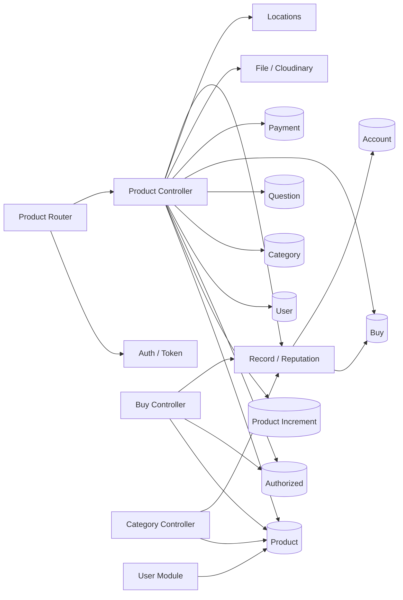

# Product — Architecture Review

Fecha: 2026-07-22  
Alcance: módulo Product completo y dependencias directas necesarias para interpretar su comportamiento.  
Naturaleza: auditoría documental; no contiene ni implica cambios de implementación.

## Resumen ejecutivo

Product mantiene las publicaciones del marketplace y expone el catálogo consultable. En el código actual también concentra búsqueda facetada, favoritos, estadísticas, preparación de contexto para una compra y cálculo de reputación comercial. El router registra 23 endpoints bajo `/api/product`; 11 requieren `Auth` y 12 son públicos.

El núcleo técnico está formado por un controller de 573 líneas, tres modelos Mongoose propios (`product`, `incrimentProduct`, `authorized`) y el componente `record.js` de 381 líneas. Product consulta directamente siete modelos de otros módulos y el filesystem/Cloudinary mediante File. A su vez, Buy, Category y User modifican o consultan productos, por lo que el límite del módulo es permeable y existen dependencias bidireccionales.

## 1. Responsabilidad del módulo

La responsabilidad principal es gestionar el ciclo de vida y descubrimiento de una publicación de venta:

- crear y editar publicaciones;
- pausar o reactivar inventario publicado;
- listar publicaciones propias o de otro vendedor;
- mostrar el detalle enriquecido de una publicación;
- buscar y filtrar el catálogo;
- registrar favoritos;
- exponer listados destacados, recientes y vendidos;
- producir métricas mensuales de publicaciones.

El módulo también actúa como orquestador de datos ajenos al agregado Product: preguntas, transacciones, pagos, usuarios, direcciones autorizadas, categorías, cuentas bancarias y reputación. Estas responsabilidades son observadas en el código; no representan necesariamente el límite de dominio deseado.

## 2. Entidades y conceptos manipulados

### Entidades propias

#### Product (`productSchema.js`)

Publicación ofertada por un usuario. Contiene propietario, número público, título, modelo, marca, precio, inventario, categoría/subcategoría, condición, multimedia, ubicación, favoritos, visitas, garantía, entrega, destacado, métricas de venta, estado y fechas.

Campos con validación Mongoose obligatoria:

- `title`;
- `price`;
- `quantity`;
- `category`;
- `subcategory`;
- `condition`.

Tiene índice de texto sobre `title`.

#### ProductIncrement (`incrementShema.js`)

Contador persistente con valor inicial `100000000` y estado inicial `1`. Se usa para asignar `Product.number` durante la creación.

#### Authorized (`authorizedSchema.js`)

Registro de datos personales/dirección asociado a un usuario: nombre, identificación, teléfono, dirección, departamento y ciudad. `predetermined` permite ordenar o marcar un registro como preferido. Aunque vive en Product, Buy lo modifica durante el proceso de compra.

### Conceptos de dominio implementados en `record.js`

#### SellerRole y BuyerRole

Catálogos embebidos de ocho niveles de reputación. Cada nivel incluye nombre, umbrales, comisión/ganancia, máximos, atributos de publicación destacada, color y requisito de cuenta bancaria.

SellerRole evalúa cantidad de ventas positivas, monto total y existencia de cuenta bancaria. BuyerRole evalúa principalmente cantidad de calificaciones positivas; algunos campos del catálogo no participan en todas las funciones.

### Entidades externas manipuladas

- **User:** propietario, vendedor, ubicación, perfil público, favoritos y exclusiones de datos sensibles al popular.
- **Category:** categorías padre y arreglos de subcategorías usados en navegación y facetas.
- **Question:** preguntas visibles de una publicación y sus clientes.
- **Buy:** ventas, calificaciones y montos usados para detalle y reputación.
- **Payment:** movimientos financieros del usuario para el contexto previo a una compra.
- **Account:** cantidad de cuentas bancarias usada para clasificar vendedores.
- **File/Image:** imágenes base64 o URLs externas procesadas mediante filesystem y Cloudinary.
- **Location:** catálogo estático de departamentos y ciudades.

## 3. Casos de uso por capacidad

### Gestión de publicaciones

- crear el contador de publicaciones;
- crear publicación y cargar imágenes;
- editar datos e incorporar imágenes nuevas;
- pausar publicación;
- reactivar publicación si existe inventario.

### Inventario del vendedor

- listar publicaciones propias por estado;
- contar publicaciones propias agrupadas por estado;
- listar publicaciones activas de otro usuario.

### Detalle y contexto comercial

- consultar detalle por `_id`;
- consultar detalle por número público;
- incrementar visitas;
- incluir vendedor, categorías, preguntas, otras publicaciones, ventas y reputación;
- obtener contexto autenticado para compra: balance de pagos y direcciones autorizadas;
- obtener una publicación autenticada para edición/consulta interna.

### Navegación de catálogo

- listar por categoría;
- listar por subcategoría;
- filtrar y construir facetas de categoría, ubicación y condición;
- buscar con filtros y texto completo;
- sugerir títulos por expresión regular.

### Favoritos

- agregar usuario al arreglo `favorite` de una publicación;
- retirar usuario del arreglo;
- listar favoritos del usuario.

### Exhibición

- listar publicaciones destacadas activas;
- listar publicaciones activas recientes;
- listar publicaciones activas con ventas, ordenadas por cantidad vendida.

### Reporting

- agrupar publicaciones normales/destacadas y activas por mes para una ventana calculada de doce meses.

### Reputación comercial (`record.js`)

- calcular nivel de vendedor;
- obtener detalle y siguiente nivel de vendedor;
- calcular nivel de comprador;
- obtener detalle y siguiente nivel de comprador;
- comparar actividad del mes actual y anterior.

## 4. Inventario de API

Prefijo efectivo: `/api/product`.

| Método | Ruta | Auth | Descripción observable | Controller | Caso de uso |
| --- | --- | --- | --- | --- | --- |
| POST | `/` | Sí | Crea publicación, asigna número/propietario/ubicación y carga imágenes. | `new` | Crear publicación |
| PUT | `/` | Sí | Actualiza por `_id`; carga `imagesNew` cuando existen. | `edit` | Editar publicación |
| PUT | `/pause` | Sí | Cambia `status` a `2`. | `pause` | Pausar publicación |
| PUT | `/start` | Sí | Cambia `status` a `1` si `quantity > 0`. | `start` | Reactivar publicación |
| GET | `/` | Sí | Lista publicaciones propias por estado y devuelve conteos agrupados. | `me` | Inventario propio |
| GET | `/user` | No | Lista publicaciones activas de un usuario y su documento User. | `user` | Catálogo del vendedor |
| GET | `/query` | No | Detalle por `_id` con vendedor, preguntas, relacionados, ventas y reputación. | `query` | Ver publicación |
| GET | `/number` | No | Detalle equivalente localizado por número público. | `queryNumber` | Ver publicación por número |
| GET | `/query-find` | Sí | Detalle para compra, reputación, balance y direcciones autorizadas. | `queryFind` | Preparar compra |
| GET | `/find` | Sí | Obtiene publicación con categoría y subcategoría. | `find` | Consultar publicación autenticada |
| GET | `/category` | No | Lista productos cuya `category` está dentro de `category.subcategory`. | `category` | Navegar categoría |
| GET | `/subcategory` | No | Lista productos cuyo campo `category` coincide con `_id`. | `subcategory` | Navegar subcategoría |
| GET | `/filter` | No | Filtra catálogo y devuelve facetas de categoría, ubicación y condición. | `filter` | Búsqueda facetada |
| GET | `/search` | No | Busca con filtros y paginación. | `search` | Buscar catálogo |
| GET | `/keywords` | No | Devuelve hasta 10 títulos que coinciden con una regex. | `keywords` | Autocompletado |
| POST | `/favorite` | Sí | Añade al usuario al arreglo de favoritos usando `$addToSet`. | `favoriteAdd` | Agregar favorito |
| DELETE | `/favorite` | Sí | Retira al usuario del arreglo mediante `$pull`. | `favoriteRemove` | Eliminar favorito |
| GET | `/favorite` | Sí | Lista productos favoritos del usuario. | `favorite` | Consultar favoritos |
| GET | `/operations` | Sí | Produce serie mensual normal/destacada/activa. | `operations` | Reporte de publicaciones |
| GET | `/outstanding` | No | Lista activos con `highlight: 'highlight'`. | `outstanding` | Publicaciones destacadas |
| GET | `/last` | No | Lista activos por orden natural descendente. | `last` | Publicaciones recientes |
| GET | `/sold` | No | Lista activos con `quantitySold > 0`, ordenados por ventas. | `sold` | Más vendidos |
| GET | `/increment` | No | Crea un documento contador. | `createIncrement` | Inicializar contador |

No existe endpoint de eliminación de una publicación en este router.

## 5. Dependencias

### Dependencias salientes

| Dependencia | Uso |
| --- | --- |
| Mongoose/Product | CRUD, conteos, agregaciones, populate, texto y actualización de métricas. |
| Auth/Token | Protege 12 rutas y aporta `req.user`/`req.token`. |
| File/Cloudinary | Carga imágenes y mantiene URLs ya existentes. |
| User | Datos de vendedor y ubicación. |
| Category | Navegación, populate y construcción de facetas. |
| Question | Preguntas visibles en el detalle. |
| Buy | Conteo de operaciones y cálculo de reputación. |
| Payment | Balance agrupado por tipo para `queryFind`. |
| Authorized | Direcciones/datos autorizados para compra. |
| Account | Requisito de cuenta bancaria en reputación. |
| Location | Catálogo estático para facetas geográficas. |

### Dependencias entrantes

- **Buy** decrementa `quantity`, incrementa `quantitySold` y pausa el producto cuando el inventario llega a cero.
- **Category** puede eliminar todos los productos y consulta listados para la portada.
- **User/Profile** actualiza ubicación de productos del usuario.
- **User/Reporting** agrega y cuenta productos para reportes generales.
- **Buy** y **Category** consumen funciones de `record.js`.
- Buy modifica registros `Authorized` definidos dentro de Product.



El grafo muestra dependencias bidireccionales Product↔Buy, Product↔Category y Product↔User a nivel de módulos/controladores.

## 6. Reglas de negocio observadas

### Creación y edición

1. Cada creación incrementa el documento `Increment` con `status: 1` y asigna el resultado a `product.number`.
2. El propietario siempre se toma de `req.user._id`; ciudad y departamento se copian desde el usuario autenticado.
3. `month` se guarda usando `Date#getMonth()` (0–11) y `year` con el año calendario actual.
4. Las imágenes se retiran temporalmente del body, el producto se guarda primero y las URLs se actualizan después de cargar.
5. `uploadImages` conserva cadenas que contienen `http`; el resto se interpreta como base64, se escribe en `uploads/`, se sube a Cloudinary y luego se elimina localmente.
6. La creación responde éxito únicamente si la lista de URLs resultante tiene al menos un elemento.
7. La edición carga `imagesNew` solo cuando su longitud es mayor que cero; luego elimina `imagesNew` e `imagesDelete` del body.
8. `imagesDelete` se lee pero su eliminación del arreglo está comentada; no produce cambio persistente.
9. Las validaciones de título, precio, cantidad, categoría, subcategoría y condición son las declaradas por Mongoose.

### Estados e inventario

1. `status: 1` se usa como publicación activa.
2. `status: 2` se usa al pausar y cuando Buy deja el inventario en cero.
3. Pausar establece estado `2` sin otra condición.
4. Reactivar solo establece estado `1` cuando `quantity > 0`; sin inventario responde HTTP 200 con `status: 0`.
5. Buy decrementa inventario por la cantidad comprada e incrementa `quantitySold` por esa misma cantidad.

### Visibilidad y detalle

1. Los listados públicos de usuario, búsqueda, destacados, recientes y vendidos filtran normalmente `status: 1`.
2. El detalle por `_id` y por número no aplica filtro de estado.
3. Una visita se incrementa si `product.user._id != req.query.user`; la comparación usa el parámetro proporcionado por el cliente.
4. Solo se incluyen preguntas cuyo estado sea distinto de `0`.
5. El detalle limita preguntas al `limit` solicitado y otras publicaciones activas del vendedor a cuatro.
6. Los campos de usuario excluidos al popular son `password`, `passwordFailures`, `status` y `__v`.

### Paginación y orden

1. La página se calcula repetidamente como `parseInt((count / limit) + 1)`.
2. El desplazamiento general es `(skip - 1) * limit`.
3. `filter` calcula desplazamiento pero consulta con `.skip(0)`.
4. Listados propios, favoritos, destacados y recientes usan orden natural descendente.
5. Vendidos ordena por `quantitySold` descendente.
6. Autocompletado limita a diez títulos.

### Filtros y búsqueda

1. Categoría usa subcategoría si viene informada; de lo contrario usa categoría.
2. Ubicación usa ciudad si viene informada; de lo contrario departamento.
3. Condición se compara directamente con el valor recibido.
4. Precio solo se filtra cuando existen simultáneamente `min` y `max`, usando límites estrictos `$gt` y `$lt`.
5. `filter` mantiene `status: 1` y añade `$text` cuando hay texto.
6. `search` reemplaza el objeto completo de filtro por `$text` cuando hay texto, descartando los filtros construidos previamente, incluido `status`.
7. Las facetas de condición se presentan siempre como `Nuevo/new` y `Usado/used`; cualquier condición agregada distinta de `new` cuenta como usada.
8. Las facetas geográficas se completan contra el catálogo estático `Location` aunque tengan conteo cero.
9. `keywords` crea una regex con opción `-i` sobre `title` usando directamente el texto recibido.

### Favoritos

1. Los favoritos se almacenan dentro de cada Product como un arreglo.
2. Agregar usa `$addToSet`, evitando duplicados exactos del mismo usuario.
3. Eliminar usa `$pull`.
4. El listado busca productos cuyo arreglo contiene `req.user._id`; no agrega filtro de estado.

### Contexto de compra

1. `queryFind` requiere autenticación.
2. Suma `Payment.amount` agrupado por `type` para movimientos del usuario con estado `1` o `2`.
3. Lista registros Authorized del usuario ordenando `predetermined` de forma descendente.
4. Incluye la reputación calculada del vendedor.

### Reputación

1. Hay ocho niveles ordenados de mayor a menor para vendedores y compradores.
2. Para vendedor, los niveles requieren simultáneamente cantidad mínima de ventas positivas, monto mínimo y cantidad mínima de cuentas bancarias.
3. Los cálculos de vendedor usan compras con `qualifySeller: 'positive'` y `user: id`.
4. `calculate2`/`info2` consideran el último mes móvil; `calculate`/`info` calculan mes actual y mes anterior y eligen según el `id` del nivel.
5. Para comprador, `infoBuyer` usa `buyer: id`; `calculateBuyer` usa `user: id`. El filtro temporal está comentado.
6. Sin operaciones calificadas se devuelve el nivel más bajo y, en funciones `info`, el nivel inmediatamente superior como `categoryNext`.
7. Los errores dentro de `record.js` se capturan y devuelven como `{}`.

### Reporting

1. Se agrupan publicaciones creadas después de una fecha calculada y con estado `1` o `2` por `month` y `highlight`.
2. Activas se agrupan por `month` con estado `1`.
3. La respuesta siempre construye doce elementos recorriendo meses hacia atrás desde el mes actual.
4. Solo los valores `highlight: 'normal'` y `highlight: 'highlight'` alimentan las dos métricas correspondientes.

## 7. Problemas arquitectónicos

### God Controller

`productCtrl.js` contiene 23 handlers y mezcla HTTP, reglas, autorización implícita, mutación de DTOs, persistencia, agregaciones, paginación, búsqueda, facetas, uploads y reporting.

### Segundo núcleo monolítico

`record.js` contiene catálogos, ventanas temporales, queries, selección de niveles, tratamiento de errores y logging. Sus seis funciones repiten grandes bloques de agregación y clasificación.

### Active Record fuera de límites

El controller importa modelos Mongoose de siete áreas y ejecuta consultas directamente. Otros módulos importan Product y lo modifican directamente, de modo que no existe un único punto de aplicación de invariantes.

### Responsabilidades mezcladas

- reputación pertenece al desempeño de compradores/vendedores, no al ciclo de vida de una publicación;
- Authorized representa datos de envío/compra, no Product;
- reporting administrativo comparte controller con catálogo público;
- File combina transformación base64, filesystem y proveedor Cloudinary;
- construcción de facetas mezcla catálogo, taxonomía y geografía dentro del handler.

### Duplicación

- detalle por `_id` y por número repite preguntas, relacionados, ventas y reputación;
- paginación y respuesta de listados se repiten;
- filtros se construyen por separado en `filter` y `search` con semántica divergente;
- cálculo de mes actual/anterior y selección de reputación se duplica;
- proyecciones de producto/usuario aparecen como objetos globales sin nombre de caso de uso.

### Acoplamiento y ciclos

- Product usa Buy para ventas/reputación y Buy modifica Product durante una compra;
- Product usa Category y Category consulta/elimina Product;
- Product usa User y User actualiza productos al cambiar ubicación;
- `record.js` es consumido por Product, Buy y Category, pero vive dentro de Product.

### Violaciones SOLID observables

- **SRP:** controller y `record.js` tienen múltiples razones de cambio.
- **OCP:** añadir un filtro, nivel o proveedor requiere editar lógica central y arreglos embebidos.
- **DIP:** presentación depende directamente de Mongoose, Cloudinary indirecto y modelos externos.
- **ISP:** no hay puertos pequeños; cada consumidor accede a modelos completos.

### Estado y contratos implícitos

Estados, condiciones, valores `highlight`, proyecciones, límites y mensajes están expresados como literales dispersos. Variables como `numPages`, `group` y `resul` se asignan sin declaración en varios lugares, creando estado global accidental en Node.js no estricto.

### Código muerto o incompleto

- `counts()` siempre devuelve `0` y no se usa;
- `fs` se importa en `productCtrl.js` y no se usa;
- eliminación de `imagesDelete` está comentada;
- exclusión de usuarios denunciados dentro de `filter` está comentada;
- hay una respuesta 500 duplicada e inalcanzable en `favoriteAdd`;
- varias variables calculadas no se consumen (`skip` en `filter`, `send`/resultados en otros flujos relacionados).

## 8. Riesgos

La clasificación describe impacto/probabilidad observados; esta sección no prescribe cambios.

### Crítico

- **Autorización de objeto insuficiente:** `edit`, `pause` y `start` requieren token, pero actualizan el `_id` recibido sin verificar que pertenezca a `req.user`.
- **Frontera de borrado externa:** `Category.load` ejecuta `Product.remove()` sin filtro, por lo que una operación del módulo Category puede eliminar todo el catálogo.

### Alto

- **Persistencia parcial al crear:** Product se guarda antes del upload; si este falla, se responde error pero queda una publicación persistida sin las imágenes esperadas.
- **Invariantes distribuidas:** Buy y User modifican inventario, estado, ventas y ubicación directamente; Product no controla todas las transiciones de sus datos.
- **Búsqueda con visibilidad divergente:** al recibir `search`, el endpoint `/search` reemplaza el filtro y deja de exigir estado activo u otros criterios construidos.
- **Estado global accidental:** asignaciones no declaradas pueden compartirse entre requests concurrentes del proceso.
- **Exposición de datos:** `/user` devuelve el documento User completo sin la proyección restrictiva usada por otros endpoints.
- **Regex controlada por cliente:** `/keywords` construye la expresión directamente y consulta MongoDB con ella.

### Medio

- **Paginación inconsistente:** fórmula de páginas, conteos con filtros distintos y `skip(0)` pueden producir metadatos/resultados discordantes.
- **Detalle público sin estado:** publicaciones no activas pueden consultarse por `_id` o número si se conoce el identificador.
- **Métrica de visitas controlable:** el cliente aporta el supuesto usuario con el que se decide incrementar visitas.
- **Crecimiento no acotado de favoritos:** cada Product acumula referencias de usuarios en un arreglo embebido sin límite declarado.
- **Reputación inconsistente:** funciones de comprador usan campos distintos (`buyer` frente a `user`) y ventanas temporales comentadas; varios módulos dependen del resultado.
- **Catálogos y reglas embebidas:** modificar niveles implica despliegue y afecta Product, Buy y Category simultáneamente.
- **Uploads secuenciales y memoria:** imágenes base64 se procesan completas, se escriben y suben una por una dentro del request.

### Bajo

- logging abundante de fechas, documentos, filtros y rutas locales;
- nombres inconsistentes (`incrimentProduct`, `new`, `query`, `queryFind`, `find`);
- mensajes y status HTTP heterogéneos, incluido 201 para “no encontrada” y para reporting;
- imports, helper y ramas comentadas sin uso;
- ausencia de tipado/documentación de query params y estados.

## 9. Oportunidades de modernización

Estas son fronteras conceptuales para una futura fase; no constituyen una propuesta de cambio inmediato.

### Presentation

Separar adaptadores HTTP por capacidad:

- administración de publicación;
- catálogo y detalle;
- búsqueda/facetas;
- favoritos;
- reporting.

La capa debería conservar explícitamente los contratos legacy mientras delega casos de uso.

### Application

Casos de uso independientes para crear, editar, cambiar estado, consultar detalle, listar inventario, buscar, gestionar favoritos y generar reportes. La composición del detalle puede expresarse como un caso de uso que coordina puertos de Question, User, Buy y Reputation sin importar modelos.

### Domain

El agregado Product puede concentrar conceptos de publicación, inventario, estado, condición, garantía y destacado. Los estados y valores actuales deben primero documentarse como lenguaje ubicuo, sin reinterpretarlos.

Reputation y Authorized son candidatos a límites separados: el primero está ligado a transacciones/usuarios y el segundo al contexto de compra/envío.

### Infrastructure

Repositorios específicos para Product e Increment; adaptadores de lectura para Category, User, Question, Buy y Payment; gateway de imágenes para File/Cloudinary; proveedor de ubicaciones; persistencia Mongoose y mappers.

### Read models

Los listados, detalle enriquecido, facetas y reporting son consultas de lectura diferentes. Pueden representarse mediante query services/repositorios de lectura separados sin imponer ese modelo al agregado de escritura.

### Pruebas previas necesarias

La modernización requerirá caracterización de cada endpoint: status HTTP, forma JSON, filtros Mongo, proyecciones, populate, orden, paginación y efectos secundarios. Casos especialmente sensibles: creación con fallo de upload, búsqueda textual, transiciones de inventario desde Buy y todos los cálculos de reputación.

## 10. Arquitectura objetivo

La siguiente estructura representa capacidades y dependencias futuras; no ha sido implementada.

```text
src/modules/product/
├── presentation/
│   ├── controllers/
│   │   ├── ProductManagementController.js
│   │   ├── ProductCatalogController.js
│   │   ├── ProductSearchController.js
│   │   ├── ProductFavoriteController.js
│   │   └── ProductReportingController.js
│   ├── routes/
│   │   └── product.routes.js
│   └── dto/
├── application/
│   ├── use-cases/
│   │   ├── publication/
│   │   ├── catalog/
│   │   ├── search/
│   │   ├── favorites/
│   │   └── reporting/
│   ├── ports/
│   │   ├── ProductRepository.js
│   │   ├── ProductReadRepository.js
│   │   ├── ProductNumberRepository.js
│   │   ├── ImageGateway.js
│   │   ├── SellerProfileReader.js
│   │   ├── QuestionReader.js
│   │   ├── TransactionReader.js
│   │   └── CategoryReader.js
│   └── services/
│       ├── ProductDetailService.js
│       └── ProductFacetService.js
├── domain/
│   ├── entities/
│   │   └── Product.js
│   ├── value-objects/
│   │   ├── ProductStatus.js
│   │   ├── ProductCondition.js
│   │   ├── Inventory.js
│   │   ├── Money.js
│   │   └── Warranty.js
│   └── policies/
│       └── PublicationStatePolicy.js
├── infrastructure/
│   ├── mongoose/
│   │   ├── schemas/
│   │   ├── repositories/
│   │   └── mappers/
│   ├── cloudinary/
│   │   └── CloudinaryImageGateway.js
│   └── location/
│       └── StaticLocationProvider.js
└── shared/
    ├── constants/
    └── pagination/
```

Límites relacionados que merecen diseño independiente:

```text
src/modules/reputation/   # reglas SellerRole/BuyerRole y lecturas de Buy/Account
src/modules/checkout/     # Authorized y contexto previo a compra
```

La dirección objetivo de dependencias sería Presentation → Application → Domain, con Infrastructure implementando puertos de Application. Product no importaría controllers ni schemas de otros módulos.

## 11. Puntuación

Escala: 1 es deficiente/bajo y 10 es excelente/alto. Las excepciones son **Acoplamiento** y **Riesgo**, donde 10 representa el máximo nivel perjudicial.

| Dimensión | Puntuación | Fundamentación |
| --- | ---: | --- |
| Cohesión | 3/10 | Publicación, búsqueda, favoritos, reporting, checkout y reputación comparten módulo. |
| Acoplamiento | 9/10 | Alto acoplamiento directo y bidireccional con siete modelos/servicios externos. |
| Escalabilidad | 3/10 | Controller monolítico, uploads dentro del request, regex/facetas y arreglos embebidos. |
| Legibilidad | 4/10 | Flujo lineal comprensible, pero nombres genéricos, duplicación, globals y literales dificultan el mapa mental. |
| Riesgo | 9/10 | Autorización de objeto, borrado externo total, persistencia parcial e invariantes distribuidas. |
| Mantenibilidad | 2/10 | Cambios de catálogo, compra o reputación atraviesan múltiples módulos sin puertos ni pruebas visibles. |

## Qué debería permanecer y qué debería cambiar de ubicación

### Permanecer conceptualmente en Product

- modelo y ciclo de vida de la publicación;
- inventario propio de la oferta y sus estados observados;
- datos descriptivos, precio, condición, garantía, multimedia y ubicación de publicación;
- asignación del número público;
- catálogo/listados de Product como capacidades de lectura;
- relación de destacado y métricas propias `visits`/`quantitySold`, mientras el dominio confirme su propiedad.

### Cambiar de ubicación en una futura refactorización

- consultas Mongoose: infraestructura/repositorios;
- parsing HTTP y respuestas: presentation;
- coordinación de creación/upload: application;
- búsqueda, facetas y read models: query services de catálogo;
- `record.js`: contexto Reputation;
- `Authorized`: contexto Checkout/Shipping;
- integración Cloudinary/filesystem: gateway de infraestructura;
- consultas a Buy, Payment, Question, User, Category y Account: puertos/adaptadores;
- reporting mensual: capacidad de reporting;
- constantes de estado, condición, destacado y paginación: lenguaje de dominio/configuración compartida apropiada.

Este reparto describe propiedad arquitectónica futura; no redefine ninguna regla ni contrato vigente.
